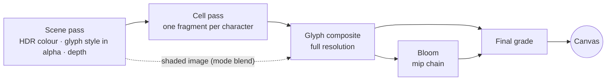

<div align="center">


<h1>N E X U S</h1>

<p><b><i>Reality is just another rendering.</i></b></p>

<p>An immersive universe rendered in real time as ASCII.<br>
Explore a procedural galaxy, inspect alien worlds, fall into a ray-marched black hole, and find what's hidden on the other side.</p>

<p>


</p>

<!-- Live demo: after enabling GitHub Pages (see "Deploying"), add your link here, e.g.
<p><a href="https://YOUR-USERNAME.github.io/YOUR-REPO/"><b>Enter the NEXUS →</b></a></p>
-->

</div>

---

NEXUS is not a website with an ASCII filter on top. Every frame is rendered as a real 3D scene, and a custom GPU pipeline then turns it into animated characters. Each object picks its own glyph set, silhouettes are drawn with oriented edge characters, and colour survives the conversion. Switch to **wireframe** or plain **shaded** rendering at any moment; the transition decodes across the screen.

## Highlights

- **A GPU ASCII engine.** Two shader passes, one per character cell and one per pixel. It uses a luminance-to-glyph table calibrated by measuring the real ink coverage of every character at startup, plus depth-based silhouette glyphs (`/ | \ -`), per-object character sets, animated glyphs and cursor lenses.
- **Three render modes.** ASCII, Wireframe and Reality, with animated transitions between them.
- **Five connected environments.** The Gateway, the Cosmos, the Planetary Archive, the Singularity and the Unknown, linked by cinematic transitions and loaded on demand.
- **A ray-marched Schwarzschild black hole.** Light paths are bent by gravity, so the far side of the accretion disk appears above the shadow and background stars are genuinely lensed. Your cursor carries a small gravitational lens of its own.
- **Hidden things.** Portals that only exist in one rendering, an impossible triangle that resolves from a single vantage point, and dimensions that invert the universe into ink on paper.
- **Generated audio.** Drones, shimmer, portal sweeps and positional sound sources, all synthesized with the Web Audio API. Nothing plays until you interact.
- **Runs on real devices.** Three quality tiers, adaptive resolution and touch controls.

## Gallery

<table>
  <tr>
    <td width="50%"><br><sub><b>01 · The Gateway.</b> The sphere materializes, ripples under the cursor and is the way in.</sub></td>
    <td width="50%"><br><sub><b>02 · The Cosmos.</b> A procedural four-arm galaxy: 70,000 stars, nebulae, an asteroid belt and megastructures.</sub></td>
  </tr>
  <tr>
    <td width="50%"><br><sub><b>03 · Planetary Archive.</b> Inspecting HALO-21 in close orbit, with its catalogue entry.</sub></td>
    <td width="50%"><br><sub><b>04 · The Singularity.</b> Real lensing: the disk's far side bends over the shadow.</sub></td>
  </tr>
  <tr>
    <td width="50%"><br><sub><b>NOVA-01 in ASCII.</b> The volcanic glyph set (<code>^ " * ~</code>) flickers upward like heat.</sub></td>
    <td width="50%"><br><sub><b>NOVA-01 in Reality.</b> The same frame, shaded.</sub></td>
  </tr>
  <tr>
    <td width="50%"><br><sub><b>05 · The Unknown.</b> A pocket dimension: a 4D tesseract, an impossible triangle, a glyph swarm.</sub></td>
    <td width="50%"><br><sub><b>Dimension β.</b> One of the hidden dimensions renders the universe as ink on paper.</sub></td>
  </tr>
</table>

### One frame, three renderings


The same frozen frame of the black hole in all three modes. **Wireframe** is drawn inside every material: barycentric triangle edges on rocks and crystals, latitude and longitude grids on planets, iso-contours on nebulae, and a lensed spacetime grid around the black hole.

## Getting started

```bash
git clone <your-repo-url> nexus
cd nexus
npm install
npm run dev          # → http://localhost:5173
```

You need **Node.js 20.19+ or 22.12+** (see [`.nvmrc`](.nvmrc)) and a browser with **WebGL2**.

| Script | What it does |
|---|---|
| `npm run dev` | Development server with hot reload |
| `npm run build` | Type-check, then production build into `dist/` |
| `npm run preview` | Serve the production build locally |
| `npm run typecheck` | Type-check only |
| `npm run build:remote-fonts` | Build that links the fonts from Google Fonts instead of bundling them |

## Controls

| Input | Action |
|---|---|
| <kbd>W</kbd> <kbd>A</kbd> <kbd>S</kbd> <kbd>D</kbd> / arrows | Fly (with inertia) |
| Drag | Look around (orbit while inspecting) |
| Wheel / pinch | Zoom |
| <kbd>Space</kbd> / <kbd>Q</kbd> | Ascend / descend |
| <kbd>Shift</kbd> | Accelerate |
| Click / tap | Select an object |
| <kbd>E</kbd> | Interact: inspect, approach, set course, enter, assemble… |
| <kbd>Tab</kbd> | Exploration index: warp anywhere, quality, glyph density, audio |
| <kbd>1</kbd> <kbd>2</kbd> <kbd>3</kbd> / <kbd>M</kbd> | ASCII · Wireframe · Reality |
| <kbd>H</kbd> | Hide the interface |
| <kbd>Esc</kbd> | Close panel → release orbit → clear target → pause |

On touch screens you get a virtual stick plus ascend, descend, interact and index buttons.

## The journey

| | Environment | How you get there |
|---|---|---|
| 01 | **The Gateway**: an ASCII sphere in the void | Start |
| 02 | **The Cosmos**: a procedural spiral galaxy | *Enter the Nexus*, which dives through the sphere |
| 03 | **Planetary Archive**: four worlds, each with its own glyph set | Select a planet and press <kbd>E</kbd> |
| 04 | **The Singularity**: SGR-Ø, the galactic core | Fly toward the bright core, or select it and *Set course* |
| 05 | **The Unknown**: what lies past the event horizon | Cross the event horizon |

<details>
<summary><b>Secrets</b> (spoilers)</summary>
<br>

- **Anomaly Σ** flickers in and out of existence near the Monolith Array. It is a shortcut into the Unknown.
- **Portal Ω** exists only in WIREFRAME mode and leads to dimension β (ink on paper).
- **Portal Δ** opens when you see the impossible triangle from its vantage point. It leads to dimension γ (infrared, with inverted curvature).
- **Portal Ψ** appears when the glyph swarm assembles into a sentence. It leads back to the Cosmos.

</details>

## How the ASCII engine works



1. **Scene pass.** The 3D scene renders into a half-float target with a depth texture. Every opaque material writes a *glyph style id* into the alpha channel, which is how each planet and structure gets its own character set.
2. **Cell pass.** One fragment runs per character cell. It supersamples the scene inside the cell, tone-maps it, and looks up the glyph whose *measured ink coverage* best matches the luminance. Then it animates the glyph per style and runs a Sobel filter on log depth to draw oriented silhouette characters.
3. **Glyph composite.** Each pixel samples a glyph atlas that is regenerated at the exact device-pixel cell size, so characters stay terminal-crisp at any density. This pass also blends in the shaded image during mode transitions and applies the cursor lens.

<p align="center"></p>
<p align="center"><sub>At 2× DPR: NOVA-01's volcanic glyphs, silhouette characters along its edge, and the Lattice's data glyphs above.</sub></p>

The full write-up, covering the render pipeline, the black hole integrator, the environment lifecycle and the performance strategy, is in **[docs/ARCHITECTURE.md](docs/ARCHITECTURE.md)**.

## Tech stack

| | |
|---|---|
| Rendering | [three.js](https://threejs.org) (WebGL2) with hand-written GLSL: custom materials, post passes, ray marching |
| Interface | [React 19](https://react.dev), styled with [Tailwind CSS 4](https://tailwindcss.com) |
| Motion | [GSAP](https://gsap.com) for cinematic transitions |
| Audio | Web Audio API, fully procedural (no audio files) |
| Tooling | [Vite 8](https://vite.dev), [TypeScript 7](https://www.typescriptlang.org) |

The engine is imperative Three.js, and React only draws the interface. High-frequency HUD values bypass React entirely, so the render loop never triggers a re-render.

## Project structure

```
src/
├── core/          Engine loop, camera rig, input, selection, transitions, quality tiers, store
├── render/        Render pipeline, glyph atlas + luminance LUT, bloom, GLSL shaders
├── materials/     Shared GPU materials: stars, space dust, nebulae, glows, 3D glyphs
├── environments/  gateway/ · cosmos/ · singularity/ · unknown/ · shared/blackhole.ts
├── audio/         Procedural Web Audio engine with HRTF spatial sources
└── ui/            HUD, panels, boot sequence, touch controls
docs/
├── ARCHITECTURE.md
└── media/         README screenshots
```

## Performance

- **Quality tiers.** *High* is the desktop default; *Balanced*; *Performance* is the default on mobile and software GPUs. Each tier sets the pixel ratio, scene resolution, particle counts, bloom levels, cell supersampling, black-hole ray steps and MSAA.
- **Adaptive resolution.** The scene's render scale follows frame time with hysteresis, and can step down a tier if a device keeps struggling.
- **GPU-side animation.** Orbits, asteroid spin, particle inspiral, dust and morphs all run in vertex shaders, and geometry is instanced throughout.
- **Lazy environments.** Each environment is its own chunk, loaded and shader-compiled during the transition into it, then disposed on exit.
- **Cheap ASCII.** In steady ASCII mode the scene renders at about half resolution, because each character only needs a few samples.

## Deploying

The build uses relative paths, so `dist/` runs from any static host or sub-path.

**GitHub Pages (included).** [`.github/workflows/deploy.yml`](.github/workflows/deploy.yml) builds and publishes every push to `main`. Turn it on once under **Settings → Pages → Build and deployment → Source: GitHub Actions**. The site appears at `https://<username>.github.io/<repository>/`.

**Anywhere else.** Run `npm run build` and upload `dist/` to Netlify, Vercel, Cloudflare Pages, S3 or similar. No server or environment variables are needed.

## Debugging

| URL parameter | Effect |
|---|---|
| `?q=high` · `balanced` · `performance` | Force a quality tier |
| `?mode=ascii` · `wireframe` · `reality` | Start in a render mode |
| `?env=gateway` · `cosmos` · `singularity` · `unknown` | Boot straight into an environment |
| `?adaptive=0` | Disable adaptive resolution |
| `?fast` | Skip the boot sequence's pacing |

`window.__nexus` exposes the engine in the console. `setFrozen(true)`, `step(dt)` and `setModeMix(ascii, wire)` freeze time, advance it frame by frame and blend render modes exactly. That makes frames reproducible; it is how the images in this README were captured.

## Browser support

NEXUS needs WebGL2 with floating-point render targets, which current versions of Chrome, Edge, Firefox and Safari provide on desktop and mobile. It was developed and tested in Chromium. If WebGL2 is unavailable, the boot sequence reports it instead of failing silently.

## Credits

- Typefaces: [Space Grotesk](https://fonts.google.com/specimen/Space+Grotesk), [IBM Plex Mono](https://fonts.google.com/specimen/IBM+Plex+Mono) and [Inter](https://fonts.google.com/specimen/Inter), all under the SIL Open Font License, bundled via [Fontsource](https://fontsource.org).
- GLSL simplex noise from [webgl-noise](https://github.com/stegu/webgl-noise) (Ashima Arts, Stefan Gustavson) and hashes from David Hoskins' *Hash without Sine*, both MIT; see [THIRD_PARTY_NOTICES.md](THIRD_PARTY_NOTICES.md).
- Bloom follows Jorge Jimenez's *Next Generation Post Processing in Call of Duty: Advanced Warfare* (SIGGRAPH 2014).

## License

[MIT](LICENSE)
