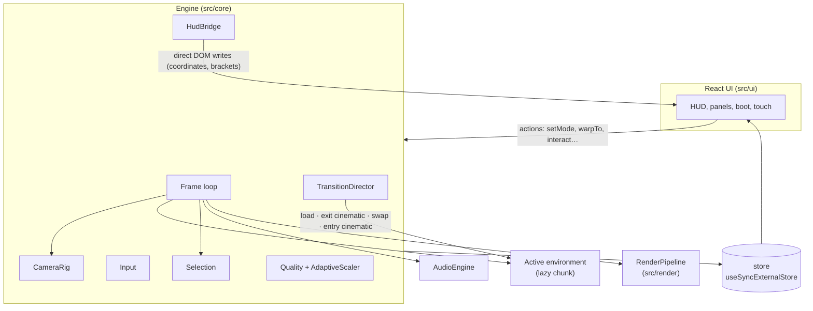
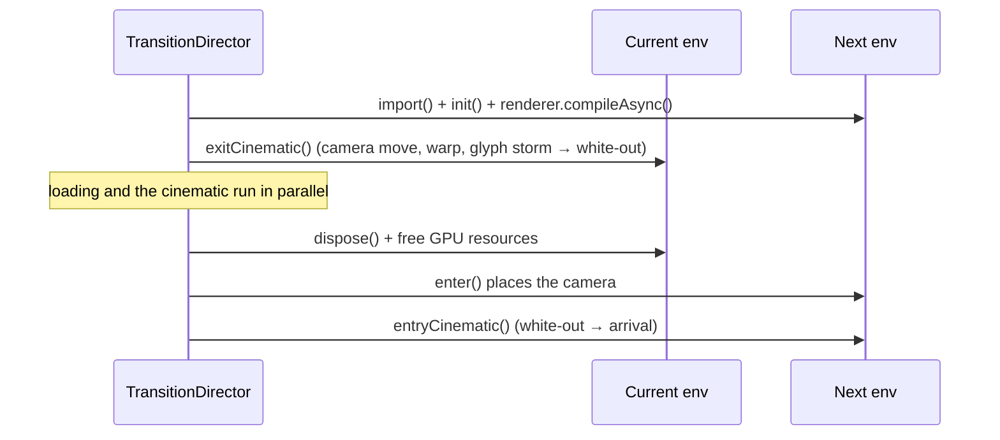
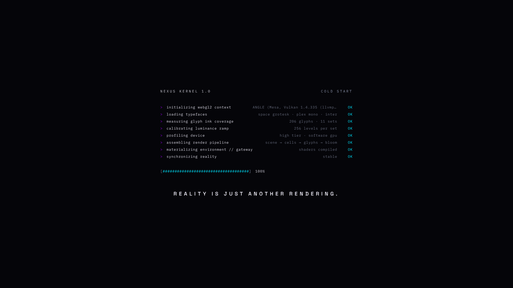

# NEXUS Architecture

This document explains how NEXUS is put together: the engine, the ASCII render pipeline, the environments and the performance strategy. For setup and controls, see the [README](../README.md).

- [Overview](#overview)
- [The frame](#the-frame)
- [Environments and transitions](#environments-and-transitions)
- [The ASCII pipeline](#the-ascii-pipeline)
- [Render modes](#render-modes)
- [The black hole](#the-black-hole)
- [Worlds and set pieces](#worlds-and-set-pieces)
- [Performance](#performance)
- [Audio](#audio)
- [Boot sequence](#boot-sequence)
- [Deterministic capture](#deterministic-capture)

## Overview



Three.js runs imperatively; React only draws the interface.

- **Low-frequency state** lives in a tiny external store that React reads with `useSyncExternalStore`: current environment, selection, render mode, panels, toasts.
- **High-frequency values** are written straight into DOM nodes that React registers through callback refs (`HudBridge`): coordinates, velocity, distance, the target bracket and the off-screen arrow. The render loop never causes a React re-render.

## The frame

`Engine.frame(dt)` runs in this order:

1. Advance time (`timeScale` lets the black hole slow time during the fall) and the shared uniforms in `core/uniforms.ts`. Every material references the same uniform objects, so one assignment updates the whole universe.
2. `Input`: keys, drag look, wheel and pinch, touch stick, pointer speed.
3. `CameraRig` runs in one of four modes: `free` (inertial flight), `orbit` (inspection), `cinematic` (driven by GSAP) or `anchored` (Gateway cursor parallax).
4. The active environment's `update()`: animation uniforms, collisions, proximity triggers, spatial audio positions.
5. Cursor ray into world space, for particles that react to the mouse.
6. `Selection`: hover picking (analytic ray–sphere with a minimum angular size, so tiny distant objects stay clickable), proximity interactions, interaction hints.
7. `HudBridge` DOM writes, the audio listener, then `RenderPipeline.render()`.
8. The adaptive resolution controller samples the frame time.

## Environments and transitions

Each environment implements one interface (`core/types.ts`):

```ts
interface Environment {
  init(engine): Promise<void>;                 // build geometry and materials
  enter(engine, from, kind): void;             // place the camera after the swap
  entryCinematic?(engine, from, kind): Promise<void>;
  exitCinematic?(engine, to, kind): Promise<void>;   // must end with the screen covered
  update(dt, time, engine): void;
  getSelectables(): Selectable[];
  getZone?(engine): ZoneId;                    // the Cosmos reports "archive" near the planets
  onQualityChange?(q): void;
  dispose(): void;
}
```

The four scenes (Gateway, Cosmos, Singularity, Unknown) are dynamic imports, so each one is a separate chunk. The Planetary Archive is a *zone* inside the Cosmos scene.



Transitions have kinds: `enter` (dive through the Gateway sphere), `singularity` (turn to the core and fall toward it), `horizon` (spiral in while time slows to a crawl), `portal` and `warp`. Each environment choreographs its own.

## The ASCII pipeline

`src/render/RenderPipeline.ts`, with shaders in `src/render/shaders.ts`.

### 1. Scene pass

The scene renders into a **RGBA16F target with a depth texture**.

- RGB holds linear HDR colour.
- Alpha holds a **glyph style id**: `alpha = (style + 0.5) / 16`. Opaque materials write it directly. Additive particles use custom blending that preserves the destination alpha, or `MAX` alpha blending when they want to claim a style (stars, the Unknown's particle formation).

| id | Style | Used by | Animation |
|---|---|---|---|
| 0 | standard | Gateway sphere, rocks, star, sky | gentle noise shimmer |
| 1 | volcanic | NOVA-01 | flicker scrolling upward |
| 2 | void | VOID-07 | slow radial breathing |
| 3 | crystal | ECHO-12, tesseract | diagonal glints |
| 4 | gas | HALO-21 | horizontal band flow |
| 5 | data | rings, Lattice, monoliths, knot | binary flicker |
| 6 | singularity | black hole, disk particles | swirl around the screen center |
| 7 | glitch | anomaly, portals, formation | row-wise scramble bursts |
| 8 | star | starfields | twinkle |

Atlas rows 9 and 10 hold the **edge** glyphs (`| / - \ _`) and the **scramble** set used for decoding effects.

### 2. Cell pass, one fragment per character

The cell pass renders into a `cols × rows` RGBA16F target.

- **Supersampling.** 2×2 or 3×3 taps (by quality tier) inside the cell. It mixes the mean with the brightest sample, so single stars survive.
- **Tone curve and black point.** `1 - exp(-c · exposure)`, then a per-environment floor so faint haze becomes empty space instead of noise.
- **Calibrated glyph choice.** At boot, `GlyphAtlas.measure()` draws every character in the loaded font and measures its ink coverage. Each ramp is sorted by coverage, and a 256-level LUT maps luminance to the glyph with the closest normalized coverage. The ramps are therefore perceptually even for the actual typeface, rather than hand-ordered.
- **Colour.** Glyphs carry the cell's hue, normalized to its brightest channel, so dim nebulae still read as coloured characters. HDR excess passes through to the bloom.
- **Silhouettes.** A Sobel filter on *log depth* across neighbouring cells. When the gradient is strong and the cell is on the near side, the glyph becomes `|`, `/`, `-` or `\` according to the gradient direction. Using log depth makes the threshold scale-invariant, from the Gateway's metres to the galaxy's kilo-units.
- **Scramble.** Cells along the mode-transition front, cells in a ring around the cursor, and global "glyph storms" during warps swap to random characters.

Output: `rgb = glyph colour`, `a = row × 32 + index`.

### 3. Glyph composite, full resolution

Each pixel fetches its cell with `texelFetch` and samples the glyph atlas. The atlas is **rebuilt at the exact device-pixel cell size** whenever the density or pixel ratio changes, so atlas texels map 1:1 to screen pixels and text stays crisp. The cursor lens is applied *before* the cell lookup, so it bends the glyph grid itself:

| Lens | Environment | Mapping |
|---|---|---|
| Magnify | Gateway, Cosmos | Fisheye bulge whose strength follows cursor speed |
| Gravitational | Singularity | Point-mass lens: source = r − E²/r, giving an Einstein ring and a small dark core |
| Glitch | Unknown | Block displacement that refreshes every few frames |

### 4. Bloom and 5. final grade

Bloom is a 13-tap downsample with a soft-knee threshold, followed by tent-filter upsampling on a half-resolution mip chain (3–5 levels by tier). The final pass applies radial chromatic aberration, a radial warp blur for jumps, horizontal glitch slices, an optional *ink on paper* inversion (dimension β), an exponential tone curve, the sRGB transfer, a vignette and film grain.

## Render modes

Modes blend through two uniforms: `asciiMix` in the pipeline and `uWire` shared by every material. They are animated together over 1.5 s.

- **ASCII ↔ other modes.** A radial *decode wave*: every cell flips at a threshold built from its distance to the center plus per-cell noise, and the front scrambles.
- **Wireframe.** Drawn inside each material, so it looks like engineered geometry rather than a debug view. A vertical scan line sweeps it in.
  - Barycentric edges on rocks, crystals and totems (`withBarycentric()` adds the attribute).
  - Latitude and longitude grids on planets and spheres (seam-safe derivatives).
  - UV face edges on beams and monoliths, and iso-contour lines on nebulae.
  - A **lensed spacetime grid** for the black hole: the same bent rays sample a coordinate grid instead of the sky, and the sky dome draws the matching grid beyond the lens sphere.
- **Reality.** The shaded scene, with 4× MSAA on the High tier.

In steady ASCII mode the scene target drops to roughly half resolution (42–50 % depending on the tier), because cells only need a few samples. During transitions it stays at full resolution.

## The black hole

`src/environments/shared/blackhole.ts`

The black hole is ray-marched inside a proxy sphere (`BackSide`, so it also works with the camera inside). Object space uses r_s = 1.

- **Photon paths.** Uses the Binet trick for Schwarzschild null geodesics: `a = -1.5 · h² · r̂ / r⁴`, where `h = |r × v|` is conserved. Integration uses adaptive steps `dt = clamp(0.075 r, 0.03, 1.8)`. The bending fades to zero near the proxy's boundary, so the lensed interior meets the unlensed sky without a seam.
- **Accretion disk.** A thin annulus in the object's XZ plane, sampled where a step crosses `y = 0`. Inner temperature runs white-cyan to cyan to purple. Keplerian swirl uses two noise layers on a 22 s cycle, cross-faded so the spirals never wind up infinitely. Relativistic **Doppler beaming** uses `g = 1 / (γ(1 − β cos θ))`, with intensity ∝ g^2.1 and the receding side shifted toward magenta. Ripples run outward like gravitational waves.
- **Photon ring.** It comes from the minimum radius each ray reaches, and is widened slightly while ASCII is active (`uAscii`) so it survives the cell grid.
- **Lensed background.** Escaped rays sample a cube map of the core-region starfield, rendered once at load. Stars and nebulae are genuinely lensed, including the Einstein ring and secondary images.
- **Particles.** Disk particles follow an analytic Keplerian inspiral with `θ(r) = θ₀ + (2c/v)(r^-½ − r₀^-½)`. They hide behind the shadow and are tugged toward the cursor ray. A tidal stream peels off the companion star HD-Ø7.

The same shader, in a cheaper configuration without a sky, draws the galactic core seen from 2.8 ku away in the Cosmos.

## Worlds and set pieces

- **Galaxy.** Four logarithmic arms with a 14° pitch, rotated so an arm passes through the Lumen system, plus an exponential disk, a bulge, field stars and arm nebulae. A sky dome adds a faint galactic band whose dust lanes follow the real plane.
- **Planets** (`cosmos/planets.ts`). Procedural fragment shaders using bump mapping from screen-space derivatives:
  - **NOVA-01:** ridged-noise lava veins.
  - **VOID-07:** near-black ice with an aurora curtain.
  - **HALO-21:** banded gas with a storm, and rings that receive the planet's shadow and are drawn as data glyphs.
  - **ECHO-12:** a faceted crystal with instanced spikes and flat derivative normals.
- **Tesseract.** 16 vertices of a 4-cube, rotated in the XW, YW and ZW planes, perspective-projected from 4D (`k = D / (D − w)`), with 32 instanced beams updated per frame.
- **Impossible triangle.** Three axis-aligned beams form a path (0,0,0) → (L,0,0) → (L,L,0) → (L,L,L). Its two ends coincide when seen along (1,1,1), so the triangle closes only from that direction. The environment checks the camera's alignment every frame.
- **Glyph swarm.** Instanced character quads drift freely. On *assemble*, target positions are laid out facing the camera, and the letters move into place while the extra glyphs dissolve.
- **Dimensions.** α, β and γ re-seed the procedural totems and swap the palette. They can also invert the output (β) or flip the curvature of the grid world (γ).

## Performance

| Tier | Pixel ratio | Scene cap | Particles | Bloom | Cell taps | Black hole steps | MSAA |
|---|---|---|---|---|---|---|---|
| High *(desktop default)* | ≤ 2 | ≤ 1.5× CSS px | 100 % | 5 levels | 3×3 | 150 | 4× |
| Balanced | ≤ 1.5 | ≤ 1.25× | 60 % | 4 | 2×2 | 96 | none |
| Performance *(mobile / software GPU)* | 1 | 1× | 35 % | 3 | 2×2 | 60 | none |

- **Device profiling** reads the unmasked GPU string (software renderers drop to Performance), coarse pointer and screen size, core count and device memory.
- **Adaptive scaler.** An exponential moving average of frame time with hysteresis: −0.1 scale after 1.2 s below 50 fps, +0.05 after 4 s above 58 fps. If it sits on the floor below 34 fps for 5 s, it drops one tier (only while *Adaptive* is on).
- **Particle budgets** change through draw ranges and instance counts, so quality switches never rebuild geometry.
- **Animation runs on the GPU.** Orbits, spin, inspiral, the dust wrap-around and morphs all live in vertex shaders. Per frame the CPU updates only a handful of uniforms and transforms; the tesseract's 48 instance matrices are the largest.
- **Disposal.** Leaving an environment frees its geometries, materials, textures and render targets. Shared resources (glyph atlas, noise texture) are flagged `userData.shared` and kept. Rendering stops while paused or when the tab is hidden.

## Audio

`src/audio/AudioEngine.ts` uses no audio files. The audio context is created only after a user gesture.

```
per-environment drones ─┐
filtered-noise "wind"  ─┼─► ambience bus ─┐
HRTF spatial sources   ─┘                 ├─► master ─► compressor ─► output
blips, sweeps, chimes  ──► sfx bus ───────┘
            └──────────► convolution reverb (generated impulse response) ─┘
```

- Drones are detuned oscillator stacks through low-pass filters with slow LFOs; each environment has its own chord and texture.
- Planets, the black hole, HD-Ø7 and the Unknown's portals are positional sources whose listener follows the camera.
- One-shots (select, interact, mode switch, portal, the collapse at the horizon) are built from oscillators, noise and envelopes.

## Boot sequence



Every line in the boot log is a real step: create the WebGL2 context and read the GPU name, load the typefaces, measure glyph ink coverage, build the luminance LUTs, profile the device, assemble the pipeline, and load and pre-compile the first environment. A step that fails is reported on screen.

## Deterministic capture

Frames can be reproduced exactly from the console or an automation script:

```js
const nexus = window.__nexus;
nexus.setFrozen(true);        // stop the real-time loop
nexus.setModeMix(1, 0);       // exact ASCII / wireframe blend (0..1 each)
nexus.step(1 / 30);           // advance the simulation and render one frame
```

The README media was captured this way in headless Chromium: posed cameras, frozen time and identical frames in all three modes.
